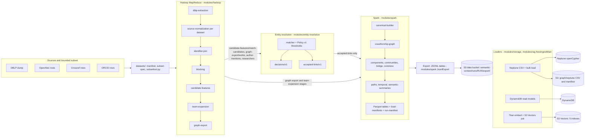
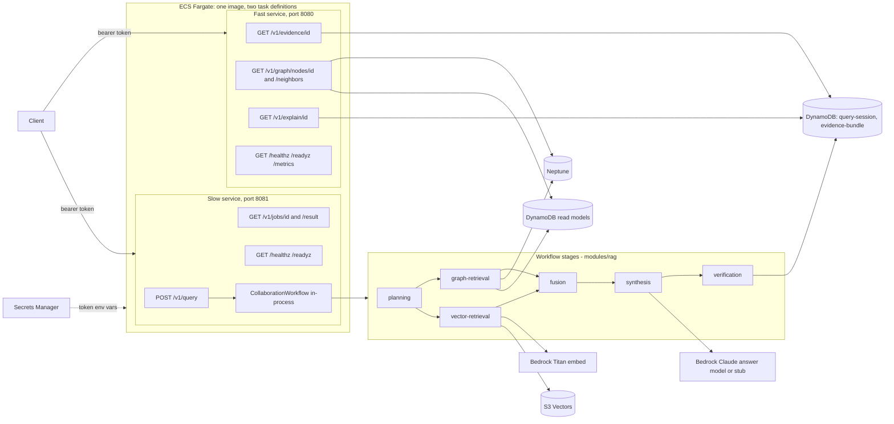

# ScholarChain architecture

Author: documentation-engineer, work order WO-B2 (Phase 17). Written from repository files only; no command was run and nothing was replayed. Status of every claim below is "as read in the cited file". Items I could not confirm are marked UNVERIFIED or NOT RECORDED. Account ids, bucket names and ARNs are not given.

Related: [data lineage](data-lineage.md), [API reference](api.md), [agent ownership map](agents.md) (owned by factory-engineer, referenced and not restated here), [evaluation](evaluation.md), [Terraform README](../infra/terraform/README.md).

## 1. What the system is

ScholarChain builds a temporal coauthorship graph from scholarly records and answers collaboration questions over it with evidence. Distributed batch jobs (Hadoop MapReduce, an entity-resolution batch, Spark) prepare and analyse the records. A runtime (two HTTP services over a retrieval, synthesis and verification workflow) reads the resulting graph and vector stores and returns an answer with an evidence bundle and an explain record (`CLAUDE.md`, "ScholarChain project memory").

## 2. Build-time architecture

Notes from the files:

- Hadoop stage names come from `Stage.ordered` (`modules/hadoop/src/main/scala/scholarchain/hadoop/pipeline/RunContext.scala:185-199`): `dblp-extraction`, `source-normalization`, `identifier-join`, `blocking`, `candidate-features`, `team-expansion`, `graph-export`. Output layout is `<root>/run=<slug>/snapshot=<digest>/stage=<stage>/<artifact>/v1` (same file, lines 95-145).
- The ER batch reads only four stage outputs of one Hadoop run (`ErBatch.scala:42-56`) and writes `decisions/v1` and `accepted-links/v1` plus `manifest.json` (`ErBatch.scala:451, 504, 752`). Spark reads only accepted links, never `decisions/` or `gold/` (`modules/spark/DESIGN.md`, "Inputs and identity").
- Spark's stage DAG is in `modules/spark/DESIGN.md` ("Stage DAG"). Its tables, `load-manifests` and `run-manifest.json` are listed in the same file under "Output".
- Loading is done by the storage adapters and the `AwsIngestMain` loader entry in the rag module (`infra/terraform/README.md`, "Loader"; `modules/storage/README.md`). The loader runs as an ECS task started by the Step Functions state machine, after EMR terminates (`infra/terraform/README.md`, "Loader-only mode" and "Pipeline bounds").
- Cloud orchestration: Step Functions creates a transient EMR cluster, runs the one pipeline script step (Hadoop, ER, Spark, export, publish), terminates the cluster, then runs the loader task (`infra/terraform/README.md`, "Pipeline bounds"). EMR runs as a single-node cluster for Spark and ER (same README, "EMR design B", "Single-node scope"); the elasticity experiment B shows managed scaling of the MapReduce stage only (`experiments/RESULTS.md` section 3.B and "Limitation P15-12").

## 3. Runtime architecture

Notes from the files:

- Two independently bounded servers, one image, two task definitions; "retrieval, ranking, synthesis and verification run in-process behind the slow server and have no network seam, so they are not separate ECS services" (`infra/terraform/README.md`, "Consolidation (runtime)"; `modules/services/src/main/scala/scholarchain/services/runtime/AwsRuntime.scala:8-27, 162-169`). Default ports fast 8080 and slow 8081 (`AwsRuntime.scala:17-18`). No public ingress is defined (Terraform README, same section).
- The timed workflow stages are `planning`, `graph-retrieval`, `vector-retrieval`, `fusion`, `synthesis`, `verification` (`modules/rag/src/main/scala/scholarchain/rag/StageTimings.scala:14-22`). A retriever the mode skips is recorded as skipped, not as 0 ms (same file, lines 24-26). Retrieval modes are `graph`, `vector`, `fused`; the default is `fused` (`RetrievalMode.scala:19-29`).
- Each downstream call goes through a deadline, bounded retries for idempotent reads and a circuit breaker (`Resilience.scala:72-219`). Pools and queues are bounded (`Http.scala:182-202`). Tokens and the cursor secret arrive as environment variables filled from Secrets Manager (`AwsRuntime.scala:29-32`).
- Titan embedding model `amazon.titan-embed-text-v2:0`, 256 dimensions, normalised (`modules/storage/README.md`, "AWS adapters"; `TitanEmbedder.scala:8,15`). The answer model defaults to `stub` when the answer-model variable is unset (`AwsSettings.scala:250-253`). There is no default Bedrock model id: `SCHOLARCHAIN_BEDROCK_MODEL_ID` is required when the answer model is `bedrock` (`AwsSettings.scala:254-259`), and the value used in a given session is in the release records, not here.
- Prompts: the workflow lists named prompts (for example `planner-classify`, `synthesis`; `Model.scala:66,77`). The full set and hashes are returned by the explain endpoint (`EvidenceService.scala:88-96`).
- The local runtime (`runtime/LocalRuntime.scala`) runs the same routers over local fakes; it was not read in detail for this document.

## 4. Module boundaries (from `CLAUDE.md`, "Module boundaries")

| Module | Rule |
|---|---|
| `core` | Shared domain, identifier, provenance, configuration and serialization contracts. No dependency on other project modules. |
| `hadoop` | Prepares publication, author, link and pair candidates. |
| `entity-resolution` | Owns match decisions. |
| `spark` (`sparkAnalytics`) | Consumes canonical, versioned graph inputs. |
| Job modules | Exchange records through core contracts and versioned artifacts, with no direct dependencies between them. |
| `storage` | Provider adapters and loaders. Uses core only. Not dependent on jobs, RAG or services. |
| `rag` | Composes retrieval, verification and synthesis against core contracts and storage interfaces. |
| `services` | HTTP and runtime composition. May depend on rag, storage and core. |
| Batch job modules | Outside the runtime dependency graph. |

The build enforces part of this. `build.sbt` declares `hadoop`, `entityResolution` and `sparkAnalytics` depending only on `core`; `storage` on `core`; `rag` on `core` and `storage`; `services` on `core`, `storage` and `rag`; the offline `evaluation` leaf on `core`, `storage`, `rag` and `sparkAnalytics`. The root takes only `test->compile` edges. A `jobSdkGuard` task fails the build when a job module has an AWS SDK jar on its runtime classpath (`build.sbt` lines 37-47, 150-178, 330-445). Whether the Terraform and script layers have their own boundary tests is outside this document.

## 5. Why each major technology is used

Reasons are quoted or paraphrased from repository records. Where a record gives no reason I say so.

| Technology | Reason in the repository | Source |
|---|---|---|
| Scala 3 and sbt multi-project build | One pinned build with format, compile and test gates (`sbt check`); version values come from one ledger. A reason for choosing Scala over another language is NOT RECORDED in the files read. | `CLAUDE.md`; `build.sbt` |
| Hadoop MapReduce on EMR | The course design names it for the preparation stage. On AWS it forces EMR on EC2: "the Hadoop stage is MapReduce, which EMR Serverless cannot run (Spark and Hive only)". A transient cluster costs nothing between runs. | `infra/terraform/README.md`, "Defaults, and why" (EMR row) |
| Entity-resolution batch | Identity is decided in one module with versioned policy thresholds, so Spark never picks an identity itself; a key with conflicting accepted links fails the Spark run. | `modules/spark/DESIGN.md`, "Identity rules"; `Policy.scala` |
| Spark | Windowed graph analytics (components, communities, coreness, bridge, paths, temporal comparison) over joins and iterations. Plans and stage metrics are kept as evidence. | `modules/spark/DESIGN.md` |
| S3 | Raw, curated, graph, semantic-context, reports and logs prefixes in two buckets; the export is the hand-off between EMR and the loader. | `ObjectStore.scala:11-17`; Terraform README, "Buckets" row |
| Neptune (openCypher) | Holds the property graph for bounded multi-hop reads. Loaded by CSV bulk load; created per session and destroyed afterwards (no snapshot). | `modules/storage/README.md`; `docs/releases/phase-15/README.md` |
| DynamoDB (on demand) | Read models and audit: run ledger, entity-link cache, query session, evidence bundle, artifact registry, researcher metric cache. No idle cost. | `DynamoDb.scala:248-614`; Terraform README, DynamoDB row |
| S3 Vectors | Semantic retrieval over Spark summaries; five versioned indexes, 256 dimensions, cosine. | `Vectors.scala:34-66`; Terraform README, "S3 Vectors" row |
| Bedrock (Titan embeddings, Claude answer model) | Embeds summaries and questions; synthesises the answer text from retrieved evidence. A stub answer model exists for experiments and tests. | `modules/storage/README.md`; `experiments/RESULTS.md` section 4 |
| ECS Fargate, two task definitions | Services run without hosts at desired count 0 between sessions; fast and slow are scaled and bounded independently. | Terraform README, "Consolidation (runtime)" and idle-cost table |
| Step Functions and SQS | State machine runs EMR then the loader; SQS with a dead-letter queue carries embedding work and gave the retry and dead-letter result in experiment F. | Terraform README, "Pipeline bounds"; `experiments/RESULTS.md` section 3.F |
| Terraform | The project rule: infrastructure only in Terraform, reviewed scripts for operations, human approvals for apply. | `CLAUDE.md`, "Project rules" |
| Secrets Manager | Runtime secrets (query token, read token, cursor secret) are never in the repository. | `CLAUDE.md`; `AwsRuntime.scala:29-32` |
| Claude Code subagent workflow | One writer per artifact class, with hooks and independent review. Described in `docs/agents.md` and the README; not restated here. | `docs/agents.md` |

## 6. Components stated as not implemented

- OpenSearch (the optional lexical or hybrid component): NOT IMPLEMENTED. `experiments/RESULTS.md` section 2 row 14 says "No OpenSearch, so no fourth mode". `infra/terraform/README.md`, section "OpenSearch", says "Not deployed", with no stub resource and no implemented or evaluated hot or hybrid tier.
- Separate vector, rank and synthesis services: NOT IMPLEMENTED as separate deployments (decision P15-47 context; `experiments/RESULTS.md` section 2 rows 19 and 20 "NOT MET as a separate service"; Terraform README, "Consolidation"). They run in-process behind the slow service.
- Neptune relationship types AFFILIATED_WITH, HAS_TOPIC and SUPPORTED_BY are not loaded; no topic summary and no topic or institution vector index source exists (`modules/storage/DESIGN.md`; `modules/spark/DESIGN.md`).
- The filters (`topic`, `venue`, `institution`) and `limits.maxResults` of the query request are validated but refused with 422 (`QueryService.scala:392-397`).
- Public ingress, a load balancer reachable from outside the VPC, and Cloud Map discovery: not created by default (Terraform README, "Defaults, and why").

## 7. Known limits that shape the architecture

- The Phase 15 experiments used a stub answer model; no Bedrock-synthesised answer passed the AWS smoke (`experiments/RESULTS.md` section 4). Later laptop evaluation is in `docs/evaluation.md`.
- Spark and ER ran on one node on EMR; node elasticity was shown for the MapReduce stage only (`experiments/RESULTS.md` section 3.B).
- Graph and vector retrieval were measured separately; under load the vector stage dominated latency (`experiments/RESULTS.md` section 3.D). The cause is UNVERIFIED there.
- The coauthorship graph is fragmented; paths and bridge scores describe small components (`modules/spark/DESIGN.md`, "Fragmentation limit").

## 8. Sources read for this document

`CLAUDE.md`; `docs/agents.md`; `build.sbt`; `modules/spark/DESIGN.md`; `modules/storage/DESIGN.md`; `modules/storage/README.md`; `modules/core/README.md`; `infra/terraform/README.md` (lines 1-301 of 485, plus the "OpenSearch" section at lines 451-453; the remainder was not read); `experiments/RESULTS.md`; `docs/releases/phase-14/README.md`; `docs/releases/phase-15/README.md`; `RunContext.scala`; `ErBatch.scala` (lines 1-80 and grep hits); `AwsRuntime.scala`; `Routes.scala`; `Resilience.scala`; `StageTimings.scala`; `RetrievalMode.scala`; `Vectors.scala`; `DynamoDb.scala` (grep hits); `AwsSettings.scala` (lines 245-265, the answer-model and model-id settings). Not read: `docs/agent-runs/phase-07/service-limits.md`, `LocalRuntime.scala`, `AwsBackend.scala`, Terraform module sources.
