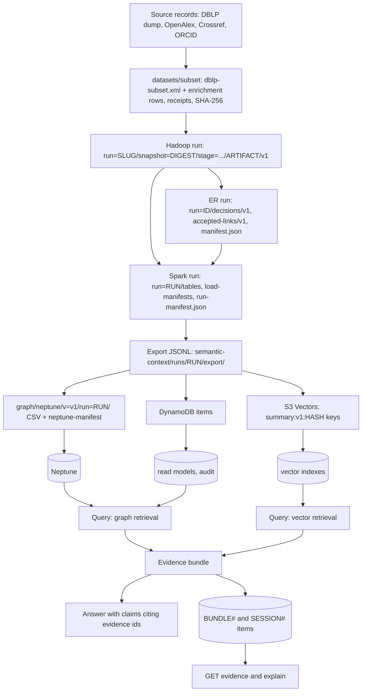

# ScholarChain data lineage

Author: documentation-engineer, work order WO-B2 (Phase 17). Written from repository files only; no command was run, no data file was read, nothing was replayed. Every identifier and count below is copied from the cited file. Anything I could not find is NOT RECORDED or UNVERIFIED. Account ids and bucket names are not given.

Related: [architecture](architecture.md), [API reference](api.md), [Spark design](../modules/spark/DESIGN.md), [storage design](../modules/storage/DESIGN.md), [core contracts](../modules/core/README.md), [datasets](../datasets/README.md), [Phase 15 results](../experiments/RESULTS.md).

## 1. The chain at a glance

## 2. Stage by stage

### 2.1 Source dataset to the bounded subset

- Registered datasets and their manifest: [datasets/README.md](../datasets/README.md). Validation and sampling are the Python tools `datasets/scripts/datasets.py` and `subsettool.py` (commands quoted in that README; NOT REPLAYED by me).
- The current subset (Phase 5): DBLP records of seed authors and one hop of coauthors, capped at 200 works per seed name, 3,500 works in total, 1,500 coauthor works, 4,000 coauthor names; enriched with OpenAlex (400 DOIs), Crossref (300 DOIs) and ORCID (100 ids) within at most 500 requests. Selection when a cap binds is by smallest SHA-256 of `salt|DBLP key`, so it is repeatable (README, "Phase 5 DBLP subset").
- Provenance at this step: each replay and download carries a receipt with `transform` and a run id; the replay run id is derived deterministically from dataset id, fixture SHA-256, transform and row count, and "is not the random UUIDv4 run identifier that the core `Provenance` contract requires" (README). The DBLP dump used is release 2026-11-05 with SHA-256 `356634eef5696aef7ba4d07d864257ddcacae55c95f64a755570801df0a82fa1` and 1,116,868,681 bytes; the registered snapshot (2026-11-01) differs, and the entry marks `release_specific_url` UNVERIFIED (README, same section). The retrieval date `2026-11-07` is inferred from file mtime, not recorded at download.
- The Phase 15 tier S snapshot id is `scholarchain-s-20261107-10dd7f34121b` (`experiments/RESULTS.md`, header). Its relation to the registered subset beyond that string is NOT RECORDED in the files I read. The dataset size S is named "the 3,472-work S subset" in `infra/terraform/README.md`, "Pipeline bounds".

### 2.2 Hadoop output

- Stages in order: `dblp-extraction`, `source-normalization` (per dataset), `identifier-join`, `blocking`, `candidate-features`, `team-expansion`, `graph-export` (`modules/hadoop/.../pipeline/RunContext.scala:185-199`).
- Path contract: `<root>/run=<slug>/snapshot=<digest>/stage=<owner>/<artifact>/v1`; the `v1` segment is the schema version so a later schema lands beside it; rejects are versioned next to accepted records (`RunContext.scala:95-150`). Each artifact has one producing job.
- Artifacts used downstream: `stage=candidate-features/match-candidates/v1`, `stage=graph-export/works/v1`, `author-mentions/v1`, `researchers/v1` (read by ER, `ErBatch.scala:42-56`); `stage=graph-export/{works,author-mentions,institutions,topics,venues}/v1` and `stage=team-expansion/{author-papers,pair-candidates,teams}/v1` (read by Spark, `modules/spark/DESIGN.md`).
- Counters, rejected-record counts and the Hadoop run id of the real-data run: NOT RECORDED in the files read for this document.

### 2.3 Entity-resolution decisions

- Input: only the four Hadoop stage outputs above; the batch accepts no other input path (`ErBatch.scala:38-42`).
- Policy: `Policy.v1`, thresholds from project configuration, accept 0.95 and reject 0.35 (`Policy.scala:158-162`; `modules/core/README.md` lists the override variables `SCHOLARCHAIN_MATCH_ACCEPT_THRESHOLD` and `..._REJECT_THRESHOLD`). A pair scoring at or above accept is accepted if its gates hold; below reject is rejected; between is unresolved; a model may be asked only about pairs inside the adjudication band (`Policy.scala:9-13`). The adjudicator in the recorded evaluation is an offline stub (`docs/evaluation.md` 2.1).
- Output: `run=<run id>/decisions/v1`, `accepted-links/v1/{researcher-links,work-links,canonical-researchers}` and `manifest.json` with SHA-256 of each output (`ErBatch.scala:348, 451, 504, 752-762`; `modules/spark/DESIGN.md`).
- Evaluation against a 230-pair gold set: precision 1.000, recall 0.802, F1 0.890 (`docs/evaluation.md` 2.1, copied from `experiments/EVALUATION.md` 6.5.1). Only accepted links define identity downstream.
- Gap carried into the graph: 896 mentions in integrity-failed clusters have a null canonical id although some carry an ORCID, so they stay separate nodes (`modules/spark/DESIGN.md`, "Metrics").

### 2.4 Spark output and export

- Run id: derived from digests of every input directory, the ER manifest, the configuration, the transform version and the SHA-256 of the module's main sources; transform version `spark-analytics/1.1.0` (`modules/spark/DESIGN.md`, "Inputs and identity" and "Output").
- Output layout: `<out-root>/run=<run id>/tables/<name>/` (Parquet, windowed tables `window=<label>/`), `load-manifests/{neptune,dynamodb,s3-vectors,s3}.json`, `run-manifest.json`, `stage-metrics.json`, `plans/`, `summary.txt`, `_SUCCESS`. Tables: nodes (researcher, work, venue, topic, institution), edges (authored, published-in, coauthored), `edge-support`, `researcher-metrics`, components, communities, bridge, coreness, `path-evidence`, `path-length-estimates`, temporal tables, `semantic-summaries`, `unresolved-mentions`, `integrity-violations` (same file).
- Every row carries `provenance` with the core Provenance fields: source `derived`, snapshot `hadoop-snapshot:<id>`, a record key, transform `scholarchain:spark-analytics/<table>`, `spark-analytics/1.1.0`, run id (same file).
- Export to S3 as JSONL tables under `semantic-context/runs/<run_id>/export/` (`infra/terraform/README.md`, "Loader"). For the Phase 15 A run the export is 17 tables, 34 objects, 373,888,058 bytes (`experiments/RESULTS.md` 3.A). The A run's graph id is `run:v1:3cfb57b1-abd1-4913-8e53-da477d8d6027` (`experiments/RESULTS.md` 3.E label). The Phase 6 observed run on the earlier subset was `312ea79b-637c-440b-85f7-5c0640c3609c`; runs written before the 1.1.0 change carry legacy mention-edge ids and "Phase 7 loaders must read only runs produced after this change" (`modules/spark/DESIGN.md`).

### 2.5 Stores

| Store | Layout and naming contract | Source |
|---|---|---|
| S3 (data bucket) | Prefixes `raw`, `curated`, `graph`, `semantic-context`, `reports`, `logs`. Tables go to `graph` for graph tables, `semantic-context` for `semantic-summaries`, otherwise `curated`. Neptune CSV under `graph/neptune/v=v1/run=<run>/`, manifest under `graph/neptune-manifest/v=v1/run=<run>/` (a prefix load never reads the manifest). Loader report under `reports/runs/<run_id>/loader/`. | `ObjectStore.scala:11-17, 247-251`; `modules/storage/README.md`; Terraform README "Loader" |
| Neptune | Vertices and edges from `SparkGraphProjector`; default scope `Extended` (AUTHORED, COAUTHORED_WITH, PUBLISHED_IN, RESOLVES_TO, DERIVED_FROM). Ids are core ids (`researcher:v1:`, `work:`, `edge:v1:`, `coauthor:v1:`, `mention-coauthor:v1:`); the `DatasetSnapshot` vertex uses the free-form provenance snapshot id. Not loaded: AFFILIATED_WITH, HAS_TOPIC, SUPPORTED_BY. | `modules/storage/DESIGN.md`; `modules/spark/DESIGN.md` |
| DynamoDB | Table names are `<prefix>-<suffix>`. Keys: run ledger `RUN#<runId>` / `META` or `STAGE#<stage>`; entity link cache `LINK#<sourceKey>` / `POLICY#<version>`; query session `SESSION#<sessionId>` / `TURN#<ordinal 6 digits>`; evidence bundle `BUNDLE#<bundleId>` / `v1`; artifact registry `ARTIFACT#<class>` / `RUN#<run>#<name>`; researcher metrics `RESEARCHER#<id>` / window-and-run key. Table suffixes beyond `run-ledger` and the Terraform names (`...-query-session`, `...-evidence-bundle`) were not each read. | `DynamoDb.scala:242-614`; `experiments/RESULTS.md` 3.D |
| S3 Vectors | Five indexes: `researcher-profile-v1`, `collaboration-community-v1`, `paper-abstract-v1`, `collaboration-path-v1`, `topic-institution-summary-v1` (the last has no source). Vector key is the Spark `summaryId` (`summary:v1:<sha256>`), a hash of summary type, window and subject, so a rerun gives the same key. Metadata carries `subjectId`, `windowStart`, `windowEnd`, `source`, `communityId`, `documentType`, `nodeKind` and evidence node ids. A changed vector under an existing key is refused. | `Vectors.scala:34-82`; `modules/storage/DESIGN.md` |

Embedding: Titan v2, 256 dimensions, model version string `amazon.titan-embed-text-v2:0-d256-norm` (`TitanEmbedder.scala:8,15`). Skipping on rerun is per vector by text hash and model (`infra/terraform/README.md`, "Loader-only mode").

### 2.6 Evidence bundle and answer

- Contract (`modules/core/.../Contracts.scala`): `EvidenceItem` (id `evidence:...`, type, optional work id, `sourceUri`, optional chunk id, optional `graphPath`, `score`, optional `confidence`, optional `text`, optional `uncertainty`, `provenance`); `EvidenceBundle` (bundle id, items, optional uncertainty, provenance; may be empty); `AnswerClaim` (claim id, text, `evidenceIds`, `verificationStatus`, optional `uncertainty`, provenance); `AnswerResponse` (query id, answer, claims, evidence bundle, provenance). Lines 402-492.
- Rules enforced in the constructors: a claim with status Verified needs evidence; a non-verified claim with no evidence must state uncertainty; every claim evidence id must resolve inside the answer's own bundle (`modules/core/README.md`, "Evidence and claims"; `Contracts.scala:484-500`).
- Provenance fields (all required): `schemaVersion`, `source`, `snapshotId`, `sourceRecordId`, `sourceUri`, `transformVersion`, `runId` (`Contracts.scala:75-90`). The run id must be a core `run` kind id (random UUIDv4); `RunManifest` binds it to dataset snapshots and configuration version (`modules/core/README.md`; `Contracts.scala:502-506`).
- At query time: the workflow persists the audit turn (`SESSION#<id>` / `TURN#<n>`) and the bundle (`BUNDLE#<id>`); the services keep an in-memory index from query id and evidence id to the session, turn and bundle (`Ports.scala:83-125`, `QueryService.scala:492-520`). That in-memory index is bounded (`records.retained`, default 500, `ServiceConfig.scala:151`), so an older answer's evidence is no longer found through the API after enough newer queries or a restart. The durable copy is in DynamoDB.
- `GET /v1/evidence/{id}` returns the item with `sourceRecord`, full `provenance`, `queryId` and `bundleId`; `GET /v1/explain/{id}` returns plan, stages, prompts (id, version, hash, schema id), models, evidence ids, score components, counters, verification report and versions (`graphRunId`, `queryRunId`, `metricVersions`, `evidenceRunIds`, `schemaHashes`) (`EvidenceService.scala:10-39, 71-135`). See [api.md](api.md).

## 3. Naming contracts (summary)

| Item | Contract | Source |
|---|---|---|
| Core ids | Type and algorithm-version prefixes; internal ids are SHA-256 over type, version and length-prefixed key fields; external work and researcher ids keep the source namespace with unpadded base64url of the source id; undirected endpoints are ordered lexicographically | `modules/core/README.md` |
| Run id | Random UUIDv4 in core; Spark run ids are derived from input and code digests; an ER run id is used in `run=<id>` with `:` replaced by `-` | `modules/core/README.md`; `modules/spark/DESIGN.md`; `ErBatch.scala:348` |
| Snapshot | Hadoop path segment `snapshot=<digest>`; Spark provenance `hadoop-snapshot:<id>` | `RunContext.scala:101`; `modules/spark/DESIGN.md` |
| Schema version | Integer `schemaVersion`, version 1 supported; path segment `v1` | `modules/core/README.md`; `RunContext.scala:93` |
| Windows | `all` or `<start>-<end>`; default `1900-1999,2000-2004,2005-2009,2010-2014,2015-2019,2020-2029,all` | `modules/spark/DESIGN.md` |
| Vector index names | Versioned (`*-v1`); a new embedding model or metadata contract means a new index name | `Vectors.scala:18-20` |

## 4. Real run ids and release-record anchors

All values are copied; I did not check them against logs.

| Item | Value | Source |
|---|---|---|
| Phase 14 loader runs 6 to 11 | Run 11 SUCCEEDED (`NEPTUNE_LOAD=LOADED`, 12 jobs `LOAD_COMPLETED`, 0 errors). Pipeline argument id begins `run-v1-192de0fd`; the graph is named for the Spark run beginning `run-v1-9f6e6fb0`, and `RUN_ID_MATCH=false` is expected. Full ids are not in the release README (truncated there). | `docs/releases/phase-14/README.md`, "Outcome" and "Open items" |
| Phase 15 reload (graph-only, A's export) | SUCCEEDED, `NEPTUNE_LOAD=LOADED vertices=32225 edges=135788` | `docs/releases/phase-15/README.md` |
| Experiment A | `exp-A-20261117T161757Z-5c69ba90` at commit `5c69ba9006b9f4a3b83d4e103d6db5710483f4e0` | `experiments/RESULTS.md` section 1 |
| Experiment B | `exp-B-20261117T185928Z-5c69ba90` | same |
| Experiment C | `exp-C-20261118T014553Z-38421c6f` at `38421c6f986ddd09cc4c1e5ac309a530f760f2a9` | same |
| Experiment D | `exp-D-20261118T002157Z-38421c6f` | same |
| Experiment E | `exp-E-20261118T012347Z-38421c6f` (mixed provenance: vectors from an earlier ingest, graph from A; the earlier ingest's `sourceRunId` is NOT STATED) | same, section 3.E |
| Experiment F1 (invalid) and F2 | `exp-F-20261118T011431Z-38421c6f`; `exp-F-20261118T013740Z-38421c6f` | same |
| Snapshot | `scholarchain-s-20261107-10dd7f34121b` (tier S) | same, header |
| Graph run for E | `run:v1:3cfb57b1-abd1-4913-8e53-da477d8d6027` | same, section 3.E |
| Deploy script digest | `961ce19b54e5bdfef3c5297e7998f0590b9abbe2a86c9c0bc4e453192820d504` | `docs/releases/phase-15/README.md` |

Run records (`run-record.env`) and raw data live outside the repository in the operator data directory; committed copies are under `experiments/results/` (`experiments/RESULTS.md` section 1). I did not open them.

## 5. Known lineage gaps

- The dataset subset registered in `datasets/` (3,500-work cap) and the "3,472-work S subset" used on AWS are described in different files; a single document tying the snapshot id `scholarchain-s-20261107-10dd7f34121b` to the subset receipt is NOT RECORDED in the files read.
- Hadoop counters and the Hadoop run id of the AWS run: NOT RECORDED here. Experiment A's input record counts, task counts, shuffle and failures are NOT DERIVED (`experiments/RESULTS.md` 3.A).
- The answer-level provenance of Phase 15 runs: the load client keeps evidence counts, not evidence ids (`experiments/RESULTS.md` section 4). Evidence-id presence per answer is NOT DERIVED.
- `path-evidence` holds 42 rows in the A export (finding P15-38 in `experiments/RESULTS.md` 3.A).
- Whether the Neptune content is row-for-row equal to the export is UNVERIFIED: Neptune could not be queried from outside the VPC and the load is evidenced by loader report lines (`docs/releases/phase-14/README.md`, "What is and is not evidenced").
- Provenance tampering controls and tests are covered in the threat model (WO-B3), not here.
