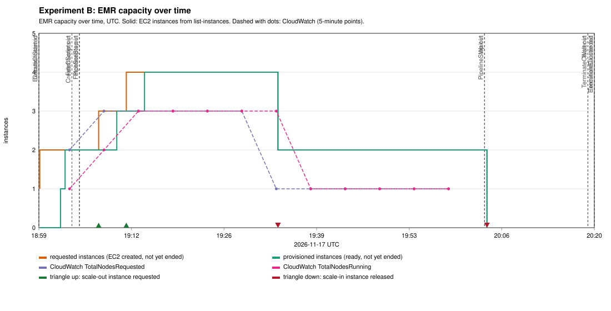
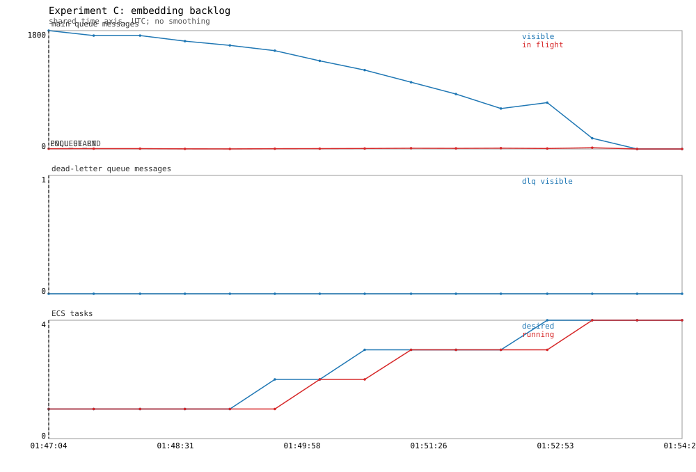
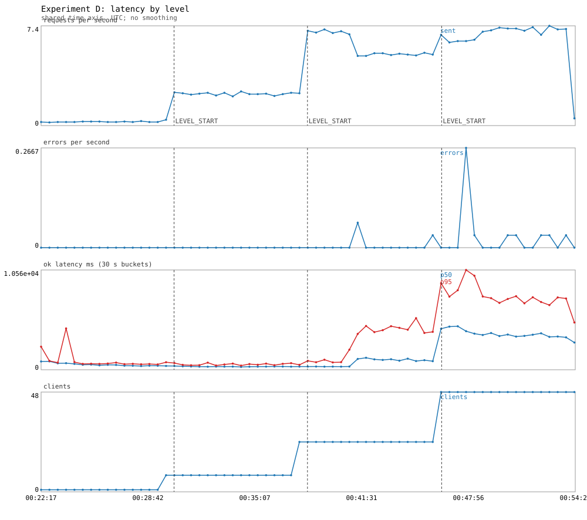
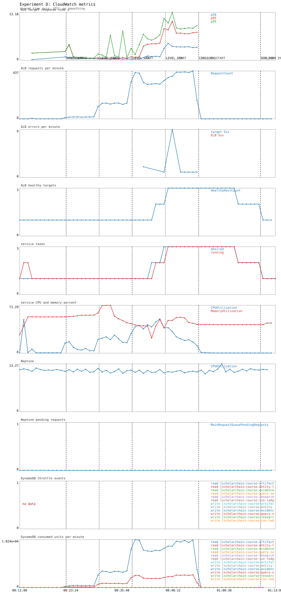
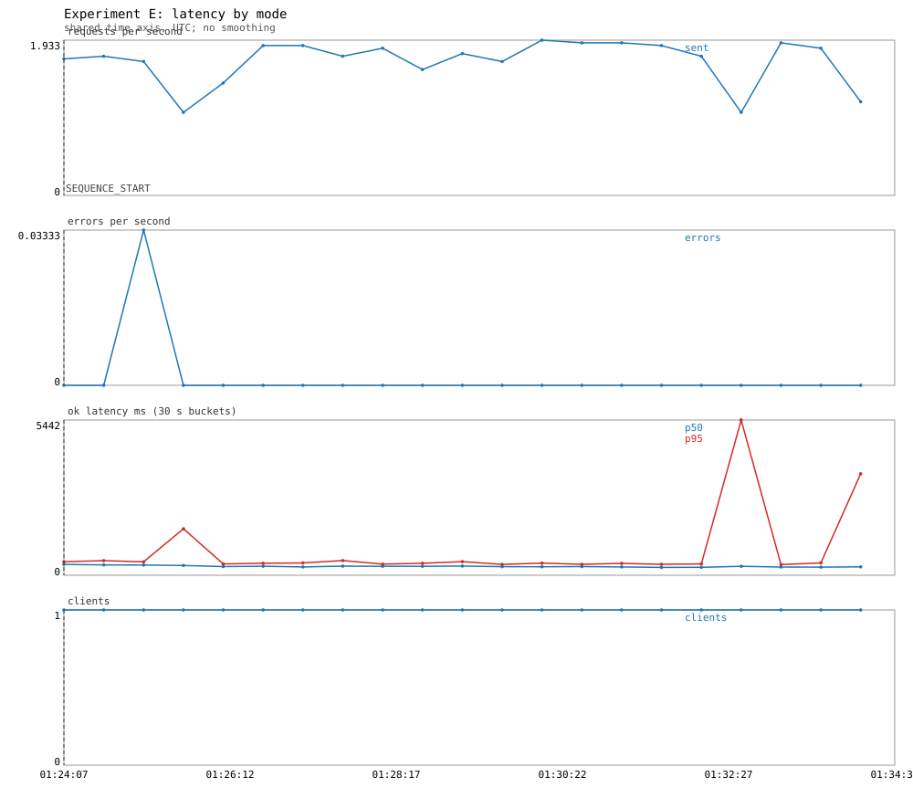
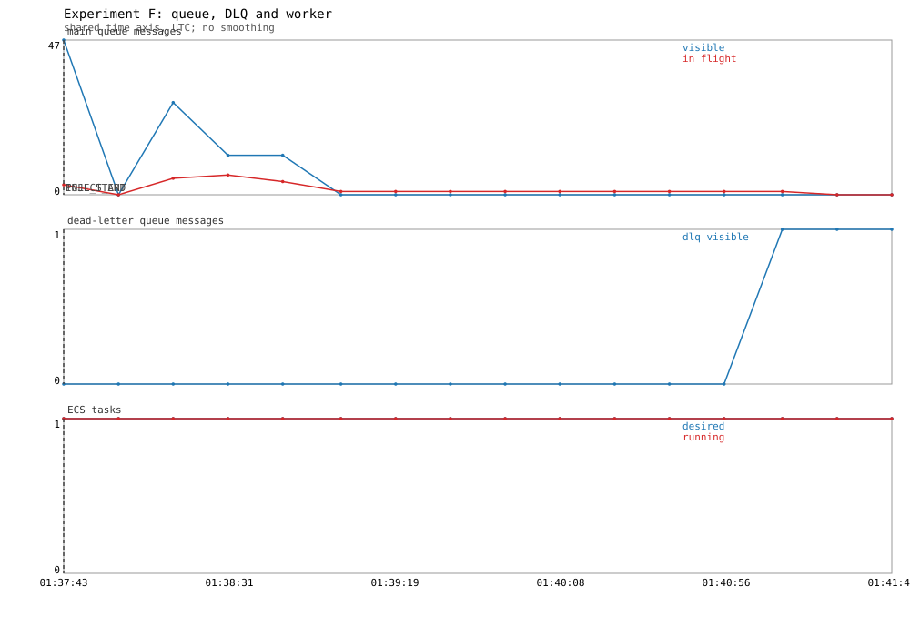

# Phase 15 AWS experiments

This page explains the six Phase 15 experiments (A to F) run on AWS in `us-east-2`: what each measured, the headline results, how to reproduce them, what they cost, and what they do not show. It summarizes repository evidence and does not replace it. The full numbers, with file citations, are in [experiments/RESULTS.md](../experiments/RESULTS.md), and the gaps are in [experiments/LIMITATIONS.md](../experiments/LIMITATIONS.md).

Status: written by the documentation-engineer from those two files and the derived files they cite. Both are marked by their author as written for independent review, so nothing here is a reviewed or accepted result. I replayed no command and re-derived no number. Every run used tier S data (one dataset snapshot), with the account ID masked in the committed copies.

## What was measured and why

The course asks the deployed system to show elastic scaling and recovery with evidence, not only to run. Each experiment targets one scaling or recovery row.

| Exp | What | Why | Component |
|---|---|---|---|
| A | Bounded Hadoop and Spark pipeline plus export at minimum EMR capacity | Baseline for duration, size and cost | EMR |
| B | A larger partition count to push EMR managed scaling out and back in | Show requested, provisioned and released capacity over time | EMR managed scaling |
| C | 2,000 embedding chunks enqueued at once | Show queue backlog, worker scale-out, throughput and drain time | SQS and ECS embedding worker |
| D | Query load at 1, 8, 24 and 48 concurrent clients | Show ECS scale-out and scale-in, and latency by level and by stage | ECS query service, ALB, Neptune, DynamoDB |
| E | The same 351 questions in graph-only, vector-only and fused retrieval modes | Compare the cost of each retrieval mode | Query service |
| F | One safe failure: a poison message plus a duplicate | Show retry, dead-letter queue (DLQ), idempotency and recovery | SQS and worker |

Experiment guides, with the derive commands for each: [A](../experiments/a-baseline/README.md), [B](../experiments/b-burst/README.md), [C](../experiments/c-embedding-backlog/README.md), [D](../experiments/d-query-load/README.md), [E](../experiments/e-retrieval-modes/README.md), [F](../experiments/f-failure-recovery/README.md). Index and rules: [experiments/README.md](../experiments/README.md).

## Headline results

Numbers are copied from [experiments/RESULTS.md](../experiments/RESULTS.md). Percentiles are nearest-rank and client-side unless stated. All answers in C to F came from an offline stub answer model, not from Bedrock Haiku (see Limitations).

### A. Baseline (not derived)

The pipeline succeeded in 3682 s (61.3 minutes) with an estimated spend of 0.61 USD. The export held 17 tables and 34 objects (373,888,058 bytes). Input records, task counts, shuffle and failures are NOT DERIVED: no derived table exists for A. Run notes: [results/a README](../experiments/results/a/exp-A-20261117T161757Z-5c69ba90/README.md).

### B. EMR managed scaling

The derive reports `scale_out_observed=yes` and `scale_in_observed=yes`. The managed scaling policy was 1 to 3 instances. Requested capacity went from 2 to 4 instances and peaked at 4 provisioned (primary plus core). The first scale-out request was at 19:08:13Z, 166 s after the pipeline step started, and took 157 s from request to ready. Two core nodes were released at 19:34:14Z, inside the pipeline step and before the 900 s wait. `ContainerPending` peaked at 348. The pipeline step lasted 3526 s.

Two caveats the derive output carries:

1. The third release (20:04:34Z) has state `INSTANCE_FAILURE`, not `TERMINATED`, yet the derive counts it as a scale-in. Whether it was a managed release or a node failing as the cluster ended is not established. The two `TERMINATED` releases at 19:34:14Z are the managed scale-in.
2. The cluster ended (20:05:37Z) about 14 minutes before the state machine entered `TerminateCluster` (20:19:12Z). The derived files do not explain this.

`TotalUnitsRequested` and `TotalUnitsRunning` returned no data, so capacity is shown in instances. Files: [summary](../experiments/results/b/exp-B-20261117T185928Z-5c69ba90/derived/summary.md), [derived.json](../experiments/results/b/exp-B-20261117T185928Z-5c69ba90/derived/derived.json), [capacity-timeline.csv](../experiments/results/b/exp-B-20261117T185928Z-5c69ba90/derived/capacity-timeline.csv), [scale-events.csv](../experiments/results/b/exp-B-20261117T185928Z-5c69ba90/derived/scale-events.csv).

### C. Embedding backlog and worker autoscaling

| Quantity | Value |
|---|---|
| Peak backlog | 1,804 |
| Drain time | 406 s |
| Throughput | about 4.9 msg/s (4.926 from polled counts) |
| Worker tasks | 1 up to a maximum of 4, back to 1 |
| Own-window outcomes | 1,950 embedded, 50 `already_done`, 0 poison |

The worker scaled out through step-scaling policies on backlog alarms. The scale-in (4 to 2 to 1) is in the autoscaling activities file, not in the derived queue summary, whose poll window ended at the drain. The derived worker counts differ from the own-window counts because the collector window starts before F2 and spans it (see Limitations). Files: [queue.svg](../experiments/results/c/exp-C-20261118T014553Z-38421c6f/derived-queue/queue.svg), [metrics.svg](../experiments/results/c/exp-C-20261118T014553Z-38421c6f/derived-metrics/metrics.svg).

### D. Query load

The requests carry `"mode": "none"` (no retrieval-mode override), and vector retrieval ran at every level. The query service scaled 1 to 2 to 3 to 2 to 1 tasks (scale-out at 00:43:03Z and 00:46:03Z, scale-in at 01:03:42Z and 01:09:45Z, all `Successful`). Latency by level (ok responses, 7,428 requests in total):

| Clients | Requests | Error rate | ok p50 (ms) | ok p95 (ms) |
|---|---|---|---|---|
| 1 | 134 | 0.0000 | 511 | 931 |
| 8 | 1,130 | 0.0000 | 338 | 598 |
| 24 | 2,840 | 0.0011 | 508 | 3,808 |
| 48 | 3,324 | 0.0042 | 3,769 | 7,990 |

Per-stage timing from the service log shows vector retrieval is the bottleneck under load: its p95 rises from 505 ms at 8 clients to 3,578 ms at 24 and 6,495 ms at 48 (p50 3,250 ms at 48), while graph retrieval stays flat at about 4 ms p50 (p95 12 to 27 ms). This is an association. The files do not show why vector retrieval slowed, so the cause is UNVERIFIED. The vector stage was skipped on 5, 35, 116 and 163 requests (levels 1, 8, 24, 48) for a reason the files do not state (UNVERIFIED). Neptune CPU stayed between 10.5 % and 13.3 %. DynamoDB throttle series returned no data (NO_DATA), read as no recorded throttle events, not a measured zero.

Files: [latency-by-level.csv](../experiments/results/d/exp-D-20261118T002157Z-38421c6f/derived-latency-v2/latency-by-level.csv), [stage-latency-by-level.csv](../experiments/results/d/exp-D-20261118T002157Z-38421c6f/derived-latency-v2/stage-latency-by-level.csv), [metrics-summary.csv](../experiments/results/d/exp-D-20261118T002157Z-38421c6f/derived-metrics/metrics-summary.csv).

### E. Retrieval modes

351 requests per mode, one client, stub synthesis. The provenance is mixed (see Limitations).

| Mode | Errors | ok p50 (ms) | ok p95 (ms) | Abstained |
|---|---|---|---|---|
| graph | 0 | 26.8 | 38.1 | 17 |
| vector | 1 | 332.5 | 469.4 | 0 |
| fused | 0 | 342.4 | 512.1 | 83 |

Stage view: graph retrieval p50 4 ms (p95 12 ms) in graph and fused modes; vector retrieval p50 315 ms in vector mode and 317 ms in fused mode. The fused latency is therefore the vector stage's. Evidence items per mode and evidence IDs are NOT DERIVED. File: [latency-by-mode.csv](../experiments/results/e/exp-E-20261118T012347Z-38421c6f/derived-latency-modes-v2/latency-by-mode.csv).

### F. Failure and recovery

The F result is the second run (F2): PASS 9, FAIL 0, INFO 3, UNKNOWN 0. One poison message (unsupported schema version) was received three times and refused each time, then landed in the DLQ. One duplicate produced exactly one embed and write, with the second delivery skipped as already done. 50 of 50 normal messages completed and the main queue drained (226 s). Files: [verdict.csv](../experiments/results/f/exp-F-20261118T013740Z-38421c6f/derived-verdict/verdict.csv), [summary.json](../experiments/results/f/exp-F-20261118T013740Z-38421c6f/derived-verdict/summary.json).

The first run (F1) is INVALID as a recovery result: the worker refused the good messages as `ChangedVectorContent`, so all 52 messages ended in the DLQ, although the harness reported `COMPLETED`. It is kept, labeled and not derived: [F1 README](../experiments/results/f/exp-F-20261118T011431Z-38421c6f/README.md).

## How to reproduce

Reproduction needs a human-run AWS session. No agent runs live scripts, and an agent cannot replay these runs. What follows is the shape of the flow, not a runbook.

1. Manifests. Each experiment has a flat `KEY=VALUE` manifest under [experiments/manifests/](../experiments/manifests/experiment-a-baseline.manifest) (the source of the approval digest) and a generated JSON copy under `experiments/manifests/json/`. Checks: [check-manifest-json.sh](../experiments/check-manifest-json.sh).
2. Plan and deploy. `bash scripts/plan.sh` records a Terraform plan digest and never applies. `bash scripts/deploy.sh` applies a saved plan. Both are documented in [scripts/README.md](../scripts/README.md); the plan script is [scripts/plan.sh](../scripts/plan.sh) and the deploy script is [scripts/deploy.sh](../scripts/deploy.sh).
3. Approval record. The human writes a single-use `KEY=VALUE` approval record that binds the action, environment, Region, cost ceiling, plan digest, script digest and exact arguments. Approval is a consistency check and the human's signature on the digest is the real control. See the [README approval section](../README.md#human-approval-points-and-the-approval-record) and [scripts/README.md](../scripts/README.md#approval-record).
4. Run. `bash scripts/run-experiment.sh` runs one approved manifest with wall-clock, first-failure and spend-estimate stops. It writes `<run id>/` once (`run-record.env`, `raw/`, `metrics/`, `SHA256SUMS`) and makes the raw data read-only. Script: [scripts/run-experiment.sh](../scripts/run-experiment.sh).
5. Collect. Each experiment has a `collect.sh` (for example [D](../experiments/d-query-load/collect.sh)) that gathers CloudWatch, autoscaling, queue and log evidence into `collected/`.
6. Derive. Plots and tables come from scripts, never from edits of raw data: [derive_latency.py](../load-tests/query-load/derive_latency.py), [metrics_derive.py](../load-tests/lib/metrics_derive.py), [queue_derive.py](../load-tests/lib/queue_derive.py), [derive-capacity.py](../experiments/b-burst/derive-capacity.py), [derive_f.py](../experiments/f-failure-recovery/derive_f.py). The exact commands are in each experiment README. The human ran every derive here, because the project guard blocks agent Python. No derive was rerun by the author of this page.
7. Committed copies. Redacted copies of the results are under [experiments/results/](../experiments/results/README.md). The committed `SHA256SUMS` hashes the redacted copies and `RAW-SHA256SUMS` keeps the raw hashes as provenance, so the two do not match by design.

Runbooks and release records for the sessions are in `docs/releases/phase-15/` (deploy-engineer's): [README](releases/phase-15/README.md), [A + B session runbook (draft)](releases/phase-15/session-ab-runbook-draft.md), [B-only runbook](releases/phase-15/session-b-only-runbook.md), [evening session runbook](releases/phase-15/session-tonight-runbook.md), [smoke record](releases/phase-15/smoke-tn.md), and the deploy records [tn-s1](releases/phase-15/deploy-tn-s1-a1.md), [tn-s2](releases/phase-15/deploy-tn-s2-a2.md), [tn-s2b](releases/phase-15/deploy-tn-s2b-a2b.md), [tn-s3](releases/phase-15/deploy-tn-s3-a3.md), [tn-s4 (teardown)](releases/phase-15/deploy-tn-s4-down.md). The decisions behind the runs (P15-nn) are in [decisions.md](agent-runs/phase-15/decisions.md); the evening session's evidence and deviations are in [session-tonight/evidence.md](agent-runs/phase-15/session-tonight/evidence.md). Load-client tooling: [load-tests/README.md](../load-tests/README.md).

## Costs

Per-run figures are estimates: an hourly burn rate multiplied by elapsed time from each run record (UNVERIFIED rates, experiment windows only, not session setup, endpoints or Neptune hours). They are not bills.

| Run | Estimate (USD) | Ceiling (USD) |
|---|---|---|
| A | 0.61 | 0.75 |
| B | 2.09 | 2.40 |
| C | 0.06 | 0.60 |
| D | 0.44 | 0.65 |
| E | 0.08 | 0.45 |
| F1, F2 | 0.03 each | 0.25 each |

Billed cost for Phase 15 is PENDING. The human reads Billing the next day against the session gate (decision P15-43): billed month-to-date 6.18 USD, lag allowance 2.27, session HIGH 4.50, total 12.95 against a limit of 14, with a human stop near 15 and an AWS spend limit of 20. Sources: [RESULTS.md section 6](../experiments/RESULTS.md) and [decisions.md](agent-runs/phase-15/decisions.md).

## Limitations

Full list (L1 to L27): [experiments/LIMITATIONS.md](../experiments/LIMITATIONS.md). The main ones:

- A is not derived. Input records, task counts, shuffle and failures are missing; its run record is not among the committed copies. A was a re-run at a different commit from the earlier S run 6, so it is not comparable line by line.
- B scaling evidence is MapReduce only. Spark and export ran on the primary node. B also carries the two caveats above.
- E has mixed provenance. Vectors come from an earlier ingest run and the graph and read models from A. Cross-mode comparisons do not describe one coherent snapshot. The earlier ingest run's identifier is not in the sources.
- F1 is invalid and is not derived. F tested one fault class only (poison plus a duplicate) with no worker scaling.
- C and F2 overlap. C's collector window starts at 01:35:53Z, before F2 (01:37:40Z to 01:41:57Z), and spans it, while C's own window starts at 01:45:53Z. The derived worker counts (2,000 embedded, 51 skipped, 3 poison) and embedding latency include F2 lines. A C-only latency and retry count are NOT DERIVED.
- Vectors were deleted outside the runbook. The human deleted vectors and purged the DLQ twice, so E cannot be rerun to the same state.
- Empty auth secrets. The query service first failed to start because three auth secrets had no value. The human filled them and force-redeployed outside the Phase 13 scripts.
- Haiku synthesis was rejected. In the smoke test every Bedrock answer was rejected and abstained. Truncation at the output-token limit is a candidate cause, but the stop reason was not logged (UNVERIFIED). C to F used the stub answer model, so no Haiku latency, cost or answer quality is measured and "LLM latency" is the stub's.
- The smoke requirement was not met. No smoke returned a graph plus vector answer with evidence IDs before D and E: SMOKE1 and SMOKE2 failed, and the stub smoke passed in graph mode only. The clients record evidence counts, not IDs.
- Combined query service. One service, `scholarchain-course-query`, scaled for retrieval, ranking and synthesis. A separately scaled vector retriever and rank and synthesis services are not shown. The latency alarm of the graph-retriever row, `query_p95_latency` ([runtime/main.tf](../infra/terraform/modules/runtime/main.tf), p95 `TargetResponseTime` of the query target group), is defined and was listed in `OK` after A2 ([deploy-tn-s2-a2.md](releases/phase-15/deploy-tn-s2-a2.md), read-only checks). It was not observed firing, so its behavior under load is not shown. The scaling dashboard is defined ([scaling_dashboard.tf](../infra/terraform/modules/observability/scaling_dashboard.tf)) and was created in A2 (same record); its contents were not read for this page.
- DynamoDB throttle series returned NO_DATA, and its billing mode was not read.
- Many abstentions. D abstained on 23, 226, 687 and 617 requests and E on 17 (graph) and 83 (fused); the reason is not captured.
- Step Functions `Retry` evidence is not shown.
